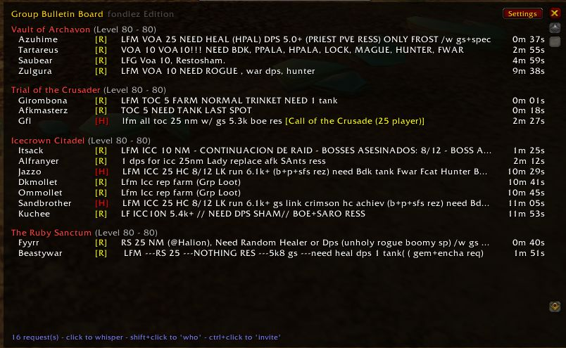
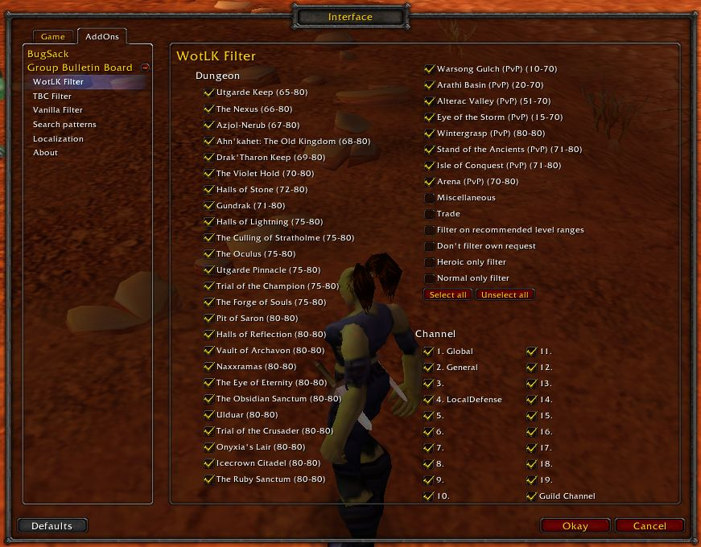

# GroupBulletinBoard (WotLK 3.3.5a)

**Version 1.3.0 - for World of Warcraft: Wrath of the Lich King 3.3.5a (build 12340)**

This is a performance-focused update of fondlez's WotLK port of GroupBulletinBoard,
made by [fiftybengt](https://github.com/fiftybengt) and Claude (Anthropic).
It fixes low FPS when the window is open while lots of people are spamming their groups.

## What's new in 1.3.0

- **Much higher FPS with the window open in busy channels.** The request list used to
  rebuild every row (even ones you'd have to scroll to) once per second. Now each row
  remembers what it shows and only updates what actually changed, and rows far outside
  the visible area aren't drawn at all (when "don't truncate" is off).
- **Faster message parsing.** Every chat message used to be de-duplicated word by word
  against every other word; it now uses a lookup table. Same results, much less work.
- **Fixed:** removing a player's old request could leave a gap in the list, so new
  requests could overwrite existing ones while the window was closed.
- **Fixed:** click / right-click / tooltip always use the request shown on that row.
- Old requests keep expiring while the window is closed.

See [changelog.md](changelog.md) for details.

## Installation

1. Download this repository (green **Code** button -> **Download ZIP**) or clone it:
   `git clone https://github.com/fiftybengt/GroupBulletinBoard-WotLK.git`
2. Put the files in a folder named exactly **`GroupBulletinBoard`** inside
   `World of Warcraft/Interface/AddOns/` (rename the extracted folder if needed, e.g.
   `GroupBulletinBoard-WotLK-main` -> `GroupBulletinBoard`). The `.toc` file must be at
   `Interface/AddOns/GroupBulletinBoard/GroupBulletinBoard.toc`.
3. If you had an older version, delete the old `GroupBulletinBoard` folder first
   (your settings are kept, they live in `WTF/`).
4. Start the game (or `/reload`), and make sure the addon is enabled on the character
   select screen ("AddOns" button). Type **`/gbb`** to open it.

## History

This is a port to WotLK (3.3.5a) of a TBC backport of a Classic TBC addon!

* 1.3.0 performance update: [fiftybengt](https://github.com/fiftybengt) and Claude (Anthropic)

* WotLK (3.3.5a) port: [fondlez](https://github.com/fondlez)
* TBC 2.4.3 backport: [Obszczymucha aka. Ohhaimark](https://codeberg.org/obszczymucha/group-bulletin-board-tbc)
* Classic TBC addon: [Vyscî-Whitemane](https://github.com/Vysci/LFG-Bulletin-Board)
* Original addon: https://legacy.curseforge.com/wow/addons/group-bulletin-board

## Description
GroupBulletinBoard (GBB) provides an overview of the endless requests in the 
chat channels. It detects all requests to the instances, sorts them and presents 
them clearly way. Numerous filtering options reduce the gigantic number to 
exactly the dungeons that interest you. And if that's not enough, GBB will let 
you know about any new request via a sound or chat notification.

Currently, English, German, Russian and Chinese dungeons are recognized 
natively. But it is easily possible to adapt GBB to any language.

To open the settings, use slash command: **`/gbb`** or click the minimap icon.

## Graphical Interface

### Main Window

### Interface Settings

## Slash Commands

`<value>` can be true, 1, enable, false, 0, disable. If <value> is omitted, the 
current status switches.

* `/gbb notify chat <value>` - On new request make a chat notification
* `/gbb notify sound <value>` - On new request make a sound notification
* `/gbb debug <value>` - Show debug information
* `/gbb reset` -  Reset main window position
* `/gbb config/setup/options` - Open configuration
* `/gbb about` - open about
* `/gbb help` - Print help
* `/gbb chat clean/organize` - Creates a new chat tab if one doesn't already 
exist, named \"LFG\" with all channels subscribed. Removes LFG heavy spam 
channels from default chat tab
* `/gbb` - open main window

## Frequently Asked Questions (FAQ)

### Q. How to blacklist a word?

From GroupBulletinBoard Settings, click on "Search patterns", make sure "Custom"
is checked, add words to "Blacklist words", then reload the user interface, e.g. 
using the `/reload` or `/reloadui` command.

## Credits

### 1.3.0 WotLK 3.3.5a performance update
* fiftybengt and Claude (Anthropic)

### Original Addon
* Arrogant_Dreamer, Hubbotu and kavarus for the Russian translation
* Baudzilla for the graphics/idea of the resize-code